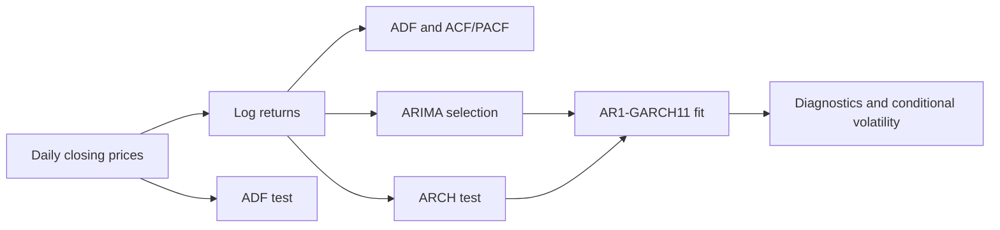

<div align="center">

# Aftershock

### Separating return dynamics from volatility persistence

**ARIMA–GARCH analysis of daily S&P 500 prices and log returns.**

[Read the report](reports/Aftershock.pdf) · [Explore the analysis](analysis/Aftershock.Rmd) · [Reproduce the study](#reproduce-the-study)

[](https://www.r-project.org/)


[](https://www.tidyverse.org/)


</div>

---

## Overview

Aftershock examines a distinction in financial time series: **weak dependence in returns can coexist with strong dependence in volatility**. The study transforms daily S&P 500 closing prices into log returns, evaluates stationarity and serial dependence, and fits an AR(1)–GARCH(1,1) model.

The source keeps observations from January 1, 2000 onward. The available local input ends on **November 4, 2020**, and contains **5,245 prices and 5,244 returns** after the date filter, matching the counts recorded in the report. The archived report's “2000–2024” labels are inconsistent with that input; this README uses the verified data coverage.

[Methods](#methods) · [Findings](#findings) · [Reproduction](#reproduce-the-study) · [Files](#repository-guide)

## Methods

| Stage | Tools | Analysis |
|:---|:---|:---|
| Preparation | `tidyverse`, base R | Sort dates, filter observations, calculate first differences of log prices |
| Stationarity | `tseries::adf.test` | Test prices and returns for a unit root |
| Mean dynamics | ACF/PACF, `forecast::auto.arima` | Examine serial dependence and select an ARIMA model |
| ARCH effects | `FinTS::ArchTest` | Test conditional heteroskedasticity with 12 lags |
| Conditional variance | `rugarch` | Fit symmetric GARCH(1,1), AR(1) mean, normal innovations |
| Diagnostics | `rugarch` fit output | Residual dependence, remaining ARCH effects, stability, and sign bias |



## Findings

The [existing report](reports/Aftershock.pdf) records:

| Quantity | Recorded result |
|:---|:---|
| Mean-model selection | ARIMA(1,0,0) with zero mean |
| Joint-model AR(1) coefficient | −0.056613 |
| ARCH coefficient, α₁ | 0.119046 |
| GARCH coefficient, β₁ | 0.865836 |
| Volatility persistence, α₁ + β₁ | **0.984882** |
| Joint sign-bias test p-value | Approximately 1.28 × 10⁻¹⁰ |

The fitted variance process is highly persistent. The report's residual dependence and ARCH diagnostics suggest that the fitted model captures much of the remaining structure, while sign-bias results indicate that a symmetric variance model leaves asymmetry to investigate.

These are fitted-model results on the historical sample. The project does not include an out-of-sample forecast evaluation or a trading-strategy backtest.

## Reproduce the study

```sh
git clone https://github.com/JimmyWu-312/Aftershock.git
cd Aftershock
```

Place the original price CSV at `data/SPX.csv`. The file is not bundled; see the [data guide](data/README.md) for the expected fields and date coverage. Open R in the repository root:

```r
install.packages(c(
  "rmarkdown", "tidyverse", "lubridate", "tseries", "knitr", "kableExtra",
  "FinTS", "forecast", "rugarch"
))

rmarkdown::render(
  "analysis/Aftershock.Rmd",
  output_dir = "reports",
  knit_root_dir = getwd()
)
```

PDF rendering requires Pandoc and LaTeX. RStudio supplies Pandoc; TinyTeX is one LaTeX option. Package versions and optimizer behavior are not pinned, so a fresh fit may differ from the archived output.

## Repository guide

```text
Aftershock/
├── analysis/Aftershock.Rmd # Data preparation, models, and diagnostic narrative
├── data/README.md          # Input schema and verified date coverage
├── reports/Aftershock.pdf  # Original rendered report
└── README.md
```

## Scope and interpretation

- The code applies a lower date cutoff only. Supplying a newer CSV extends the fitted sample and changes the experiment.
- Some numerical interpretations are hard-coded in the notebook narrative rather than extracted from fitted objects. If the data or fit changes, review those passages alongside the new outputs.
- The symmetric GARCH model uses normal innovations. The significant sign-bias diagnostic motivates further model comparison; it is not evidence that an asymmetric model has already been fitted here.
- Missing returns are omitted, but plotting dates are formed by dropping the first price date. Inputs with missing or nonpositive closing prices require additional alignment checks.
- The local source is included with the input path adapted and a malformed inline R expression corrected. The published PDF is preserved, including its original labels and narrative.

## Author and references

**Jimmy Wu** · [GitHub](https://github.com/JimmyWu-312)

The [report](reports/Aftershock.pdf) cites Engle (1982), Bollerslev (1986), Campbell, Lo & MacKinlay (1997), and Box, Jenkins, Reinsel & Ljung (2015).
